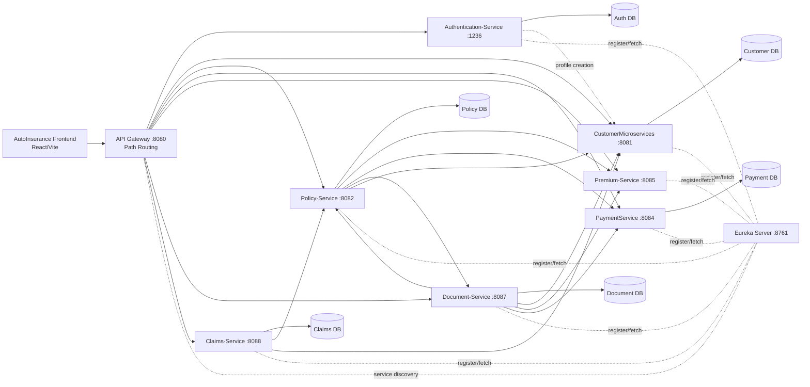
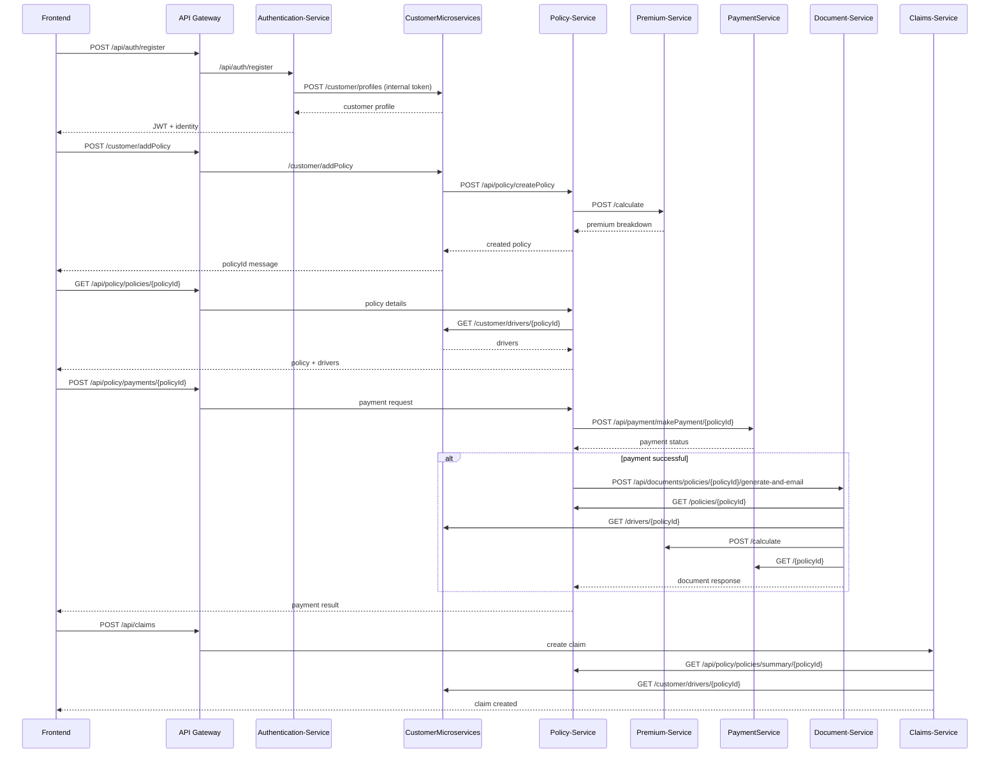

# AUTO INSURANCE APPLICATION ANALYSIS

## 1) Application Overview

This application is a React + Spring Cloud microservices system for auto insurance quote creation, payment, policy issuance, document generation, and claim filing.

Core layers observed in code:
- Frontend: React/Vite client handles authentication, quote flow, payment initiation, policy/document viewing, and claims UI.
- Edge: API Gateway routes all frontend API calls to backend services via path-based routing.
- Service discovery: Eureka server is used by services and gateway.
- Backend microservices:
	- Authentication-Service: customer login/register/JWT identity.
	- CustomerMicroservices: profile creation, policy request orchestration, customer policy listing, driver storage.
	- Policy-Service: quote/policy record creation, premium call, payment orchestration, activation/renewal.
	- Premium-Service: premium calculation from drivers/vehicles/discounts.
	- PaymentService: payment processing and payment history persistence.
	- Document-Service: policy PDF generation/storage/email and retrieval.
	- Claims-Service: claim creation/tracking/status updates with ownership checks.

---

## 2) High-Level Architecture (Mermaid)



---

## 3) Complete Customer Journey (Mermaid)

```mermaid
flowchart TD
		A[Customer Registration\nPOST /api/auth/register] --> B[Customer Login\nPOST /api/auth/login]
		B --> C[Customer Summary\nGET /customer/policies]
		C --> D[Create Quote Flow]

		D --> D1[Driver Details]
		D1 --> D2[Vehicle Details + Discounts + Coverages]
		D2 --> D3[POST /customer/addPolicy\nCustomer service validates request]
		D3 --> D4[Policy-Service createPolicy\nStatus: Pending Payment]
		D4 --> D5[Premium-Service /calculate\nreturns premium breakdown]
		D5 --> D6[Quote Created]

		D6 --> E[Coverage Review / Customer Summary Step]
		E --> F[Payment\nPOST /api/policy/payments/{policyId}]
		F --> G[Policy Activated\nPolicy Status -> Active, Type -> Issued]

		G --> H[Auto Document Generate + Email Trigger\nPOST /api/documents/policies/{policyId}/generate-and-email]
		H --> I[Policy Details View\nGET /api/policy/policies/{policyId}\nGET /api/payment/{policyId}\nGET /api/documents/policies/{policyId}]

		I --> J[Claims]
		J --> K[Create Claim\nPOST /api/claims]
		J --> L[Track Claim\nGET /api/claims/customer/{customerId}]

		subgraph Coverage Types Enforced
			C1[COLLISION]
			C2[COMPREHENSIVE]
			C3[PERSONAL_INJURY_PROTECTION]
			C4[ROADSIDE_ASSISTANCE]
		end

		D2 --> C1
		D2 --> C2
		D2 --> C3
		D2 --> C4
```

---

## 4) Step-by-Step Technical Mapping

| Step | Frontend Component / Function | API Endpoint Called by Frontend | Gateway Route | Backend Controller -> Service | Main Entities/DTOs | Input | Output | Next Step |
|---|---|---|---|---|---|---|---|---|
| Register | CustomerRegistration + register() | POST /api/auth/register | /api/auth/** -> authentication-service | AuthController.register -> AuthenticationService.register | RegisterRequest, AuthUser, AuthResponse, CustomerProfileRequest/Response | firstName,lastName,email,phone,password,confirmPassword | JWT + customer identity data | Login |
| Login | CustomerLogin + login() | POST /api/auth/login | /api/auth/** | AuthController.login -> AuthenticationService.login | LoginRequest, AuthResponse | email,password | JWT + customer identity data | Customer summary |
| Session identity | AuthProvider.refreshMe + getCurrentCustomer() | GET /api/auth/me | /api/auth/** | AuthController.me -> AuthenticationService.currentUser | CustomerIdentityResponse | Bearer JWT | memberId/customerId/name/role | Continue secured flows |
| Load policies | CustomerSummary + getAllPolicies() | GET /customer/policies | /customer/** -> CustomerMicroservices | CustomerController.getCustomerPolicies -> CustomerService.getPoliciesForCustomer | Driver, Policy | JWT with customerId | List<Policy> for named-insured customer | Continue quote or open details |
| Create quote (frontend submit) | QuoteFlow handleVehicleSubmit -> createPolicy() | POST /customer/addPolicy | /customer/** | CustomerController.addPolicy -> CustomerService.addPolicy | PolicyDetails (drivers,paymentType,coverageDetails), Driver, Vehicle, Coverage | Drivers with vehicles/discounts/coverages | message: Policy Created Successfully with ID ... | Frontend fetches policy details |
| Policy creation in Policy-Service | Indirect (via Customer service Feign) | POST /api/policy/createPolicy | /api/policy/** -> Policy-Service | PolicyController.createPolicy -> PolicyService.createPolicy | PolicyDetails DTO, Policy entity, PremiumRequest, PremiumResponseDTO | Drivers + paymentType + coverageDetails (+ deductible field if sent) | Saved Policy with policyId/premium/status Pending Payment | Coverage review + payment |
| Premium calculation | Indirect (Policy -> Premium Feign) | POST /calculate | direct service call by Policy service | PremiumController.calculatePremium -> PremiumCalculationService.calculatePremium | PremiumRequest, DriverDTO, VehicleDTO, PremiumResponse | drivers->vehicles->discounts | base/adjustments/discount/final premium | persisted in policy |
| Payment | QuoteFlow handlePaymentSubmit -> makePayment() | POST /api/policy/payments/{policyId} | /api/policy/** | PolicyController.makePayment -> PolicyService.makePayment | PaymentRequest, Policy entity | policyId + amount + paymentMethod | payment status string | If successful, policy activated |
| Payment processing | Indirect (Policy -> Payment Feign) | POST /api/payment/makePayment/{policyId} | /api/payment/** -> PaymentService | PaymentController.makePayment -> PaymentServiceImpl.makePayment | PaymentRequest, Payment entity | policyNumber, amount, paymentMethod | Payment persisted with status | Policy service checks success text |
| Auto document generation | Indirect (Policy -> Document Feign) | POST /api/documents/policies/{policyId}/generate-and-email | /api/documents/** -> Document-Service | DocumentController.generateAndEmail -> DocumentService.generateAndEmail | Document entity, DocumentResponse, PolicyDto, PremiumDto, PaymentDto | policyId + JWT | Document metadata + optional email status | Policy details/document access |
| View policy details | QuoteFlow/CustomerSummary + getPolicyDetails() | GET /api/policy/policies/{policyId} | /api/policy/** | PolicyController.getPoliciesByMemberId -> PolicyService.getPoliciesByPolicyId | Policy + driver list merge | policyId | Policy with drivers | Show final policy screen |
| View payments | getPolicyPayments() | GET /api/payment/{policyId} | /api/payment/** | PaymentController.getPaymentsForPolicy -> PaymentServiceImpl.getPaymentsForPolicy | Payment entity | policyId | List<Payment> | Show payment section |
| List/generate/email docs | PolicyDetails component | GET /api/documents/policies/{policyId}; POST /api/documents/policies/{policyId}/generate; POST /api/documents/{documentId}/email | /api/documents/** | DocumentController -> DocumentService methods | DocumentResponse, EmailRequest | policyId/documentId + JWT | document metadata + email state | Download/view/send email |
| Download PDF | fetchPolicyDocumentPdf() | GET /api/documents/{documentId}/download?disposition=... | /api/documents/** | DocumentController.download/view -> DocumentService.download | PDF bytes + metadata | documentId + JWT | Blob/PDF stream | User reads/downloads policy document |
| Create claim | ClaimsPage submitClaim + createClaim() | POST /api/claims | /api/claims/** -> Claims-Service | ClaimController.createClaim -> ClaimService.createClaim | CreateClaimRequest, Claim entity, ClaimResponse | customerId,policyId,ACCIDENT,incident details,estimatedDamageAmount | Created claim (status SUBMITTED) | Claims tracking |
| Get claims by customer | ClaimsPage + getClaimsByCustomer() | GET /api/claims/customer/{customerId} | /api/claims/** | ClaimController.getByCustomer -> ClaimService.getClaimsByCustomer | ClaimResponse | customerId + JWT | List<ClaimResponse> | User sees history |
| Get claims by policy/status update | insuranceServices helpers | GET /api/claims/policy/{policyId}; PATCH /api/claims/{claimId}/status | /api/claims/** | ClaimController.getByPolicy/updateStatus -> ClaimService methods | UpdateClaimStatusRequest | policyId or claimId+status | claim list / updated claim | Claim lifecycle management |

---

## 5) Microservice Communication Flow (Mermaid)



---

## 6) Coverage Model and Flow Notes

### 6.1 Active coverage model in current flow

Observed active model:
- Coverage is vehicle-level: Driver -> Vehicle -> Coverages[].
- Allowed coverage types enforced in Customer service validation:
	- COLLISION
	- COMPREHENSIVE
	- PERSONAL_INJURY_PROTECTION
	- ROADSIDE_ASSISTANCE
- Coverage limit is required and must be > 0.
- Duplicate coverage type per vehicle is blocked.
- At least one coverage per vehicle is required.

Frontend behavior observed:
- Quote flow supports multiple vehicles and per-vehicle coverages.
- Coverage limit is captured for each selected coverage.
- Deductible is not part of the active frontend payload.

Backend behavior observed:
- Customer service validates and forwards policy creation.
- Policy service stores premium and policy fields and performs payment activation.
- Document service summarizes selected coverages from vehicle coverages for PDF/email.

---

## 7) Implemented vs Partially Implemented vs Future Scope

### 7.1 Implemented (code present and connected)

- JWT-based login/register/me/logout flow with protected frontend routes.
- End-to-end quote creation path:
	- frontend quote form -> customer addPolicy -> policy createPolicy -> premium calculation.
- Multi-driver + multi-vehicle data model through quote flow and policy retrieval.
- Vehicle-level coverages and limits with validation in customer service.
- Payment flow through Policy service orchestrating Payment service.
- Policy activation on successful payment.
- Automatic policy document generation/email attempt after activation.
- Document listing/generation/download/email endpoints and frontend actions.
- Claims creation and listing with ownership and policy eligibility checks.
- API Gateway routing for auth/customer/policy/payment/claims/documents.
- Eureka registration/fetch configured across gateway/services.

### 7.2 Partially implemented / coexistence patterns

- Policy entity still contains legacy fields:
	- coverageDetails string
	- deductible BigDecimal
	These coexist with active vehicle-level coverages used in driver/vehicle payloads and documents.
- Frontend summary pages still render some customer fields (DOB/license) from available customer/driver data sources in display logic.
- Mixed service-to-service addressing exists:
	- some Feign clients use service-name discovery style.
	- some Feign clients use fixed localhost URLs.

### 7.3 Future scope (not fully realized by current wiring)

- Full migration to a single coverage representation in all persistence models (remove legacy policy-level coverage string/deductible usage where no longer needed).
- Consistent service discovery strategy for all Feign clients (remove hardcoded localhost where desired).
- Expanded claims lifecycle roles/workflow (current status update endpoint exists; role-based adjuster/admin processing flow is not shown in the inspected frontend).
- Broader policy lifecycle UI coverage (renewal endpoint exists; dedicated frontend renewal flow is not explicitly implemented in the inspected components).

---

## 8) Key Observations and Constraints from Current Code

- Claims creation currently supports ACCIDENT claim type only (service validation).
- Document generation requires policy status ACTIVE/ISSUED/COMPLETED and a COMPLETED payment record.
- Customer service blocks new policy creation if an ACTIVE or ISSUED policy already exists for that customer.
- API client applies Authorization bearer token from session storage and clears session on non-public 401 responses.

---

## 9) Summary

The application is a functioning microservices-based insurance workflow where the frontend drives a secured quote-to-issue journey across customer, policy, premium, payment, document, and claims services through API Gateway. The current active coverage design is vehicle-level with four enforced coverage types and mandatory limits, while some legacy policy-level coverage/deductible fields remain in Policy service for coexistence.
